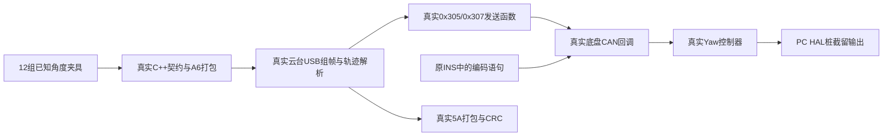

# 双板坐标链路离线诊断

日期：2026-11-27。配套下位机源提交：`44b6a73ca261177d81184919213490f02ff84651`。

本轮只增加上位机仓库中的主机诊断工具、测试夹具和文档。下位机固件、PID、机械限位、符号、齿比、USB/CAN格式及安全保护均未修改。没有打开串口、连接探针、烧录、启动ROS或运行电机。

## 当前结论

报文编解码和两帧配对可通过主机回归；Yaw坐标验收仍阻断。测试报告的 `host_checks_passed=true` 只表示代码表现与当前源码契约一致，`coordinate_acceptance` 单独报告未完成机械确认，不能用前者覆盖后者。

静止示例（单位均已换算到度，以下是夹具数据）：

| 原始IMU Yaw(rad) | A6世界Yaw(rad) | 0x300编码 | 0x305目标(°) | 底盘控制当前角(°) | 最短角误差(°) |
|---:|---:|---:|---:|---:|---:|
| 0 | 0 | 4096 | 0 | -180 | -180 |
| 1 | 1 | 5399 | -57.29 | -122.739 | 65.449 |
| -1 | -1 | 2792 | 57.29 | 122.695 | -65.405 |
| 1 | -1 | 5399 | 57.29 | -122.739 | -179.971 |

前三行把上位机世界Yaw与IMU设为同一角度，第四行反向输入只用于隔离π原点问题。这说明不能把所有工况都简化成“固定差180°”；实际还包含Yaw符号关系。没有机械证据前，不自动加π、改符号或修改零位。

Pitch使用 `q_ref=q_measured-(p_world_ref-p_world_measured)`。夹具 `q=-0.15,p=0.14,p_ref=0.268172` 得到机械目标 `-0.278172rad`；相同世界目标、`q=-0.28` 时则超出机械下限而拒绝（原因9）。这证明是否可达依赖真实机械位置，不能只检查上位机世界角。速度、加速度同乘当前Pitch符号；该标量映射没有加入底座俯仰导致的时变偏置导数，移动底座/大Roll工况仍待实测。

## 诊断实际运行什么



- 运行12组向量：Yaw零点、正负1rad、±π附近、符号隔离、日志Pitch、不可达Pitch、两轴导数及上限、valid=0、错误CRC。
- 9组可执行向量各运行4种CAN情形，共36组：先305、先307、缺307、两帧序号不符。前两种应配对；后两种从空缓存开始不得成为有效轨迹。
- 检查两级外推、弧度/度、两种字节序、定点量化及速度/加速度符号。每个底盘进程最后模拟S档，断言截留的Yaw电流输出为零。
- IMU编码使用从当前 `INS_task.c` 提取的原始C语句编译；没有另写替代编码公式。提取边界不匹配时直接停止。
- 两板分开编译，分别使用Keil Target中的头文件搜索路径，避免同名头文件串板。传感器、RC、底盘回传健康信息和时间由主机夹具提供。
- 0x300/遥控健康帧由夹具封装；没有运行真实 `senddata_task` 调度器，因此不据此证明发送周期、任务抖动或总线时延。
- 记录19个相关固件文件的SHA256，运行前后比对，确保这些文件未被工具修改。

没有运行硬件AHRS采样、完整ROS检测/TF/弹道/MPC节点、真实USB/CAN、DM4310电机控制任务或实车运动。缺帧后已有旧参考的保留/停车行为由固件现有 `trajectory_can` 和 `yaw_state` 测试覆盖，不能由本工具的空缓存缺帧用例替代。

## 使用

需要Python 3.9+、C11/C++14主机编译器，以及完整配套 `infantry2.1` 源码。本机验证使用GCC13.2；PATH里的旧MinGW GCC6.3有已记录的数值测试差异，应明确指定已验证工具链，不修改控制参数来迁就旧工具链。

```bash
python3 tools/diagnose_coordinate_chain.py --firmware /path/to/infantry2.1
```

Windows本机可在仓库根目录执行：

```powershell
python tools/diagnose_coordinate_chain.py `
  --firmware 'E:\RoboMaster\002\integration\infantry2.1\infantry2.1' `
  --cc 'E:\Productivity\x86_64-13.2.0-release-win32-seh-ucrt-rt_v11-rev0\mingw64\bin\gcc.exe' `
  --cxx 'E:\Productivity\x86_64-13.2.0-release-win32-seh-ucrt-rt_v11-rev0\mingw64\bin\g++.exe'
```

可用 `--result /path/to/result.json` 指定报告路径。程序只编译临时主机可执行文件并写诊断报告，不生成或覆盖板上固件。

报告默认保存到 `validation/offline-coordinate-chain.json`，包含实际A6/5A/305/307 HEX、每组解析原因、控制角及参考速度、编译器版本、源提交和哈希。预期的坐标差被明确标为待确认，不当作运动正确性PASS。

本轮GCC13.2验证结果：新增12组向量、36组CAN情形通过；原固件17/17套主机测试通过，原上位机协议/世界契约/真实MCU解析互通3/3套通过。结果分别保存在 `validation/offline-coordinate-chain.json`、`validation/offline-firmware-regression.json`、`validation/offline-world-contract-regression.json`。Keil Target源码未改，本轮没有重新构建ARM固件或进行ROS2构建、硬件验收。

## 实车静态验收表（尚未执行）

先核对两板运行固件与源码一致。本轮世界Pitch新固件此前记录为未烧录，不能用旧N档恢复记录证明它已上车。首轮只读观察保持S档；此时执行许可为0是预期结果，不要求I52变成1。机械摆位仅在驱动已卸力、机构确实可自由活动时进行，并保留IMU与编码器有效反馈，不强推锁定的电机。若断开电机电源导致反馈失效，该行标为无效，不能拿缓存位置做标定。

| 姿态 | 机械朝向/角度说明 | 5A Yaw(rad) | 云台I11(ticks) | 底盘received_imu_yaw.yaw_enc | 底盘set_6020pos(°) | I4机械Pitch(rad) | I54 IMU Pitch(rad) |
|---|---|---|---|---|---|---|---|
| 正前、接近水平 | 待记录 | | | | | | |
| 相对正前向左 | 待记录 | | | | | | |
| 相对正前向右 | 待记录 | | | | | | |
| 原Yaw、抬高Pitch | 待记录 | | | | | | |
| 原Yaw、降低Pitch | 待记录 | | | | | | |

S档底盘设定角的具体值不作为机械零位标定依据；重点比较原始反馈与坐标还原关系，实际目标映射先由离线向量诊断。

VOFA沿用现有FireWater通道，不新增帧或重排索引：

| 通道 | 数据 | 核对目的 |
|---|---|---|
| I0/I1/I2 | 运行秒/遥控在线/C=0,N=1,S=2 | 确认记录有效与模式 |
| I3/I4/I5 | Pitch控制目标/机械位置/电机速度 | 机械域，单位rad、rad/s |
| I11 | 云台IMU Yaw编码0～8191 | **不是GM6020机械编码器** |
| I46/I47 | 最近解析原因/host valid | 区分协议拒绝与控制门控 |
| I48/I49 | A6输入世界Pitch/转换后的机械Pitch | 检查角度映射 |
| I50 | 最近帧本地接收后年龄(ms) | 不包含host age，不能当作总年龄 |
| I51/I52/I53 | 轨迹新鲜/允许执行/准入阻断位 | S档不允许执行是预期 |
| I54 | IMU Pitch(rad) | 与机械位置成对记录 |
| I59 | 最近A6序号 | 关联输入，不是板上执行ACK |
| I60/I61 | 机械Pitch下/上限 | 仍为-0.39/+0.07rad |
| I62/I63/I64/I65 | 动态世界下/上界、世界输入开关、对齐有效 | 对齐失效时边界不能使用 |

现有5A没有GM6020机械编码器、DM机械位置、真实角速度或执行ACK。底盘控制量须通过只读调试器快照取得，不能从VOFA I11或5A凭空推断。5A姿态步距为0.01rad，校核误差应包含约0.573°的量化步距。

A6中的2ms USB运输预算和3ms CAN预算仍是配置契约。没有同步时钟或采样时间戳，未计入字段的运输/排队时间不能由MCU自动还原；主机夹具的虚拟时间无法证明现场延迟已满足预算。

完成静态记录后才能决定：Yaw的公共原点、正方向、相机/IMU/炮管外参，以及Pitch的一维映射是否足够。随后另行安排受控C档验证；本工具不会替代或自动开始这些步骤。
